# Viajes Horizonte

Aplicación de agencia de viajes desarrollada en React donde los usuarios exploran destinos, revisan los vuelos y hoteles disponibles en cada uno y arman su viaje con el costo total. Los destinos se obtienen desde una **API REST mock** y los vuelos y hoteles desde una **API GraphQL mock**, ambas implementadas con **MSW (Mock Service Worker)** y consumidas con `fetch` y **Apollo Client**.

**Sitio publicado:** https://m-vargas-h.github.io/viajes-miguel-vargas-pfy2202/

Desarrollo Frontend II (PFY2202) · Semana 5 · Actividad sumativa "Integrando nuestro frontend con backend".

## Tecnologías
- React 19 + Vite
- React Router v7 (`react-router`): rutas anidadas con Layout, parámetros dinámicos y lazy loading
- Apollo Client 4 (`@apollo/client` + `graphql`): consultas GraphQL con `useQuery` y caché normalizada
- MSW 2 (Mock Service Worker): backend REST y GraphQL simulado en el navegador
- Tailwind CSS v4: tema con `@theme` y clases reutilizables con `@apply`
- gh-pages para el despliegue en GitHub Pages

## Funcionalidades
- **Inicio:** presentación de la agencia y accesos rápidos a cada destino.
- **Destinos (REST):** listado con país, continente, descripción y actividades populares. Filtro por continente y búsqueda por nombre o país (sin distinguir tildes).
- **Detalle de destino:** información del destino (REST) y pestañas **Vuelos** y **Hoteles** (GraphQL) con precios, fechas y disponibilidad. Filtro "solo con disponibilidad" y orden por precio.
- **Mi viaje:** el usuario elige un vuelo y un hotel del destino, indica pasajeros y noches y ve el desglose y el total. Avisa si las fechas del vuelo no calzan con la disponibilidad del hotel. El plan se mantiene al recargar la página.
- **Simulador del servidor:** selector en el pie de página para probar cómo responde la aplicación ante fallas del backend (REST y GraphQL).

## Páginas y rutas
| Ruta | Página | Datos |
|------|--------|-------|
| `/` | Inicio | REST `/api/destinos` |
| `/destinos` | Destinos | REST `/api/destinos` |
| `/destinos/:destinoId` | Detalle de destino | REST `/api/destinos/:id` + GraphQL `ObtenerVuelos` y `ObtenerHoteles` |
| `/mi-viaje` | Mi viaje | Estado global (Context + `localStorage`) |
| `*` | No encontrada | — |

Las rutas se definen en `src/routes/AppRoutes.jsx` como rutas anidadas de `Layout` (Header + `Outlet` + Footer). Las páginas se cargan con `React.lazy` y `Suspense`. El `BrowserRouter` usa `basename` con la base del sitio y el build genera `404.html` para que una ruta interna recargada en GitHub Pages siga funcionando.

## Backend mock (MSW)
Los handlers están en `src/mocks/handlers.js` y los datos en `src/mocks/datos/`. Cada respuesta tiene un retraso simulado de 800 ms. `src/main.jsx` inicia el worker antes de renderizar la aplicación; se mantiene activo en producción porque el sitio publicado no tiene un backend real.

### API REST: destinos
| Método | Endpoint | Respuesta | Errores |
|--------|----------|-----------|---------|
| GET | `/api/destinos` | Lista de destinos (`id`, `nombre`, `pais`, `continente`, `descripcion`, `actividades`) | — |
| GET | `/api/destinos/:id` | Un destino | 404 si no existe |

Cliente: `src/api/clienteApi.js` (fetch con tiempo límite de 5 s) y `src/api/destinosApi.js` (rutas, validación del formato y caché en memoria).

### API GraphQL: vuelos y hoteles
Endpoint `/graphql`. Las consultas están en `src/graphql/consultas.js` y el cliente Apollo en `src/graphql/cliente.js`.

```graphql
query ObtenerVuelos($destinoId: ID!) {
  vuelos(destinoId: $destinoId) {
    id aerolinea numeroVuelo origen llegada
    fechaSalida fechaRegreso escalas duracion
    precio asientosDisponibles
  }
}

query ObtenerHoteles($destinoId: ID!) {
  hoteles(destinoId: $destinoId) {
    id nombre estrellas ubicacion precioNoche
    disponibleDesde disponibleHasta habitacionesDisponibles servicios
  }
}
```

Si el destino no existe, la respuesta trae el arreglo `errors` con el código `NOT_FOUND`, como un servidor GraphQL real.

### Simulador del servidor
El selector del pie de página (`src/mocks/escenario.js`) cambia la respuesta de **todos** los endpoints REST y GraphQL. La opción se guarda en `sessionStorage`.

| Escenario | Respuesta del mock |
|-----------|--------------------|
| Normal | Datos correctos |
| Error 500 del servidor | Estado 500 con mensaje de error |
| Sin conexión | Falla de red (`HttpResponse.error()`) |
| Respuesta lenta | Retraso de 8 s, supera el tiempo de espera del cliente (5 s) |
| Respuesta con formato inválido | Estado 200 con una estructura distinta a la esperada |

## Manejo de errores
REST y GraphQL se muestran con los mismos componentes (`MensajeError`, `AvisoRespaldo`) porque ambos se traducen a un `ErrorApi` (`src/api/errores.js`). Los errores de Apollo se convierten en `src/graphql/errores.js`.

| Tipo | Causa REST | Causa GraphQL | Acción |
|------|------------|---------------|--------|
| `noEncontrado` | Estado 404 | `errors` con código `NOT_FOUND` | Volver a destinos |
| `servidor` | Estado 5xx | `ServerError` con estado 5xx | Reintentar |
| `red` | `fetch` falla | `TypeError` de red | Reintentar |
| `tiempoAgotado` | Más de 5 s | Más de 5 s (`fetch` del `HttpLink` con tiempo límite) | Reintentar |
| `formatoInvalido` | Datos que no pasan la validación | Respuesta sin `data` o datos que no pasan la validación | Reintentar |

## Manejo de estado
- **`useState`:** filtros de continente y búsqueda, pestaña activa, filtro de disponibilidad, escenario del simulador y plan de viaje.
- **`useEffect`:** peticiones REST en `useConsulta` (con cancelación al desmontar) y guardado del plan de viaje en `localStorage`.
- **Context:** `ViajeProvider` comparte el plan de viaje entre el detalle del destino, la página Mi viaje y el contador del menú.
- **Caché:** respuestas REST en memoria por 5 minutos (`src/api/cache.js`) y caché normalizada de Apollo para GraphQL (al volver a una pestaña ya consultada se muestra al instante).

## Estructura del proyecto
```
src/
├── api/            Cliente REST, rutas de destinos, caché y errores
├── components/     Componentes reutilizables (tarjetas, filtros, mensajes, layout)
│   └── pages/      Home, Destinos, DetalleDestino, MiViaje, NoEncontrada
├── constants/      Configuración de la API y límites del plan de viaje
├── context/        Contexto y proveedor del plan de viaje
├── graphql/        Cliente Apollo, consultas gql y traducción de errores
├── hooks/          useConsulta (REST), useConsultaGraphql (Apollo), useViaje
├── mocks/          Worker MSW, handlers REST y GraphQL, escenarios y datos
├── routes/         Definición de rutas
└── utils/          Formato de precios y fechas, validaciones
```

`VuelosDestino` y `HotelesDestino` solo configuran el componente genérico `OpcionesViaje` (carga, error, filtro y orden), que a su vez usa `TarjetaVuelo` o `TarjetaHotel`.

## Diseño responsivo
Grilla de 1 columna en teléfono, 2 en tablet y 3 en PC. El menú y los filtros se reacomodan con `flex-wrap`, y en Mi viaje el resumen pasa al costado desde 1024 px.

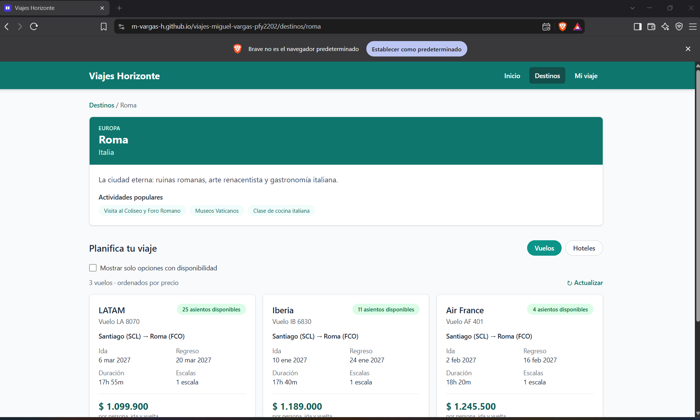 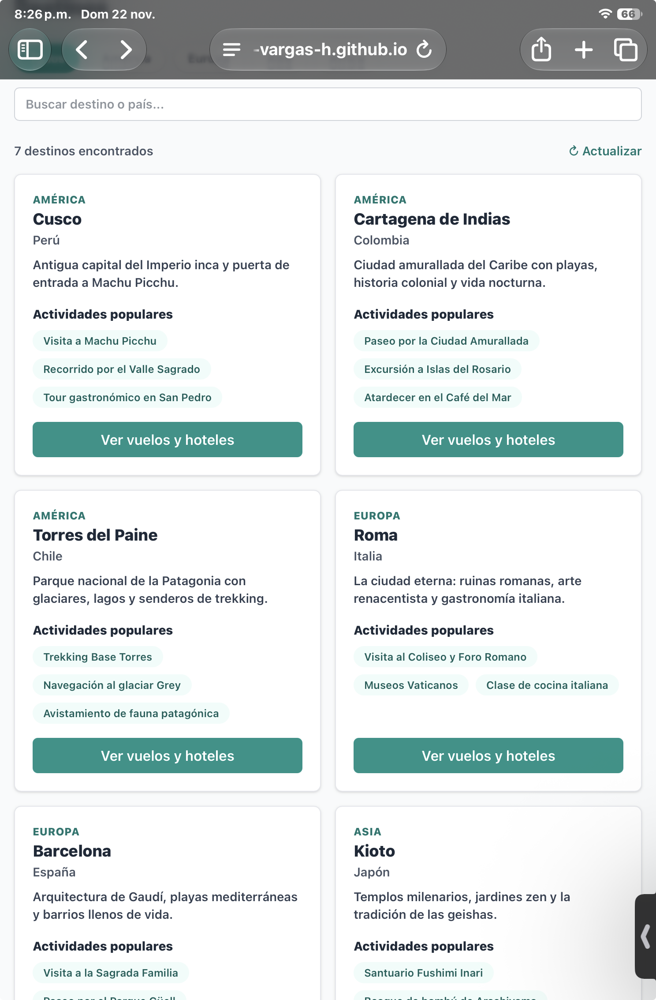

Las demás capturas de cada vista (destinos, vuelos, hoteles, Mi viaje y un estado de error) están en las carpetas [`docs/capturas/pc`](docs/capturas/pc), [`docs/capturas/tablet`](docs/capturas/tablet) y [`docs/capturas/telefono`](docs/capturas/telefono).

## Pruebas en navegadores
La aplicación se probó en Brave (PC), Opera (teléfono) y Safari (tablet). Cada prueba se realizó en los tres navegadores; se adjunta una captura de uno de los dispositivos.

1. **Inicio:** se muestran los accesos rápidos a los destinos (teléfono).

   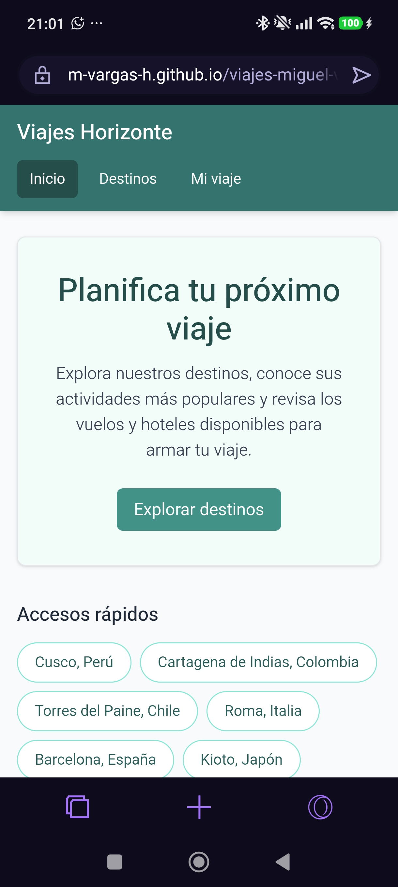

2. **Destinos:** listado, filtro por continente y búsqueda sin tildes (PC).

   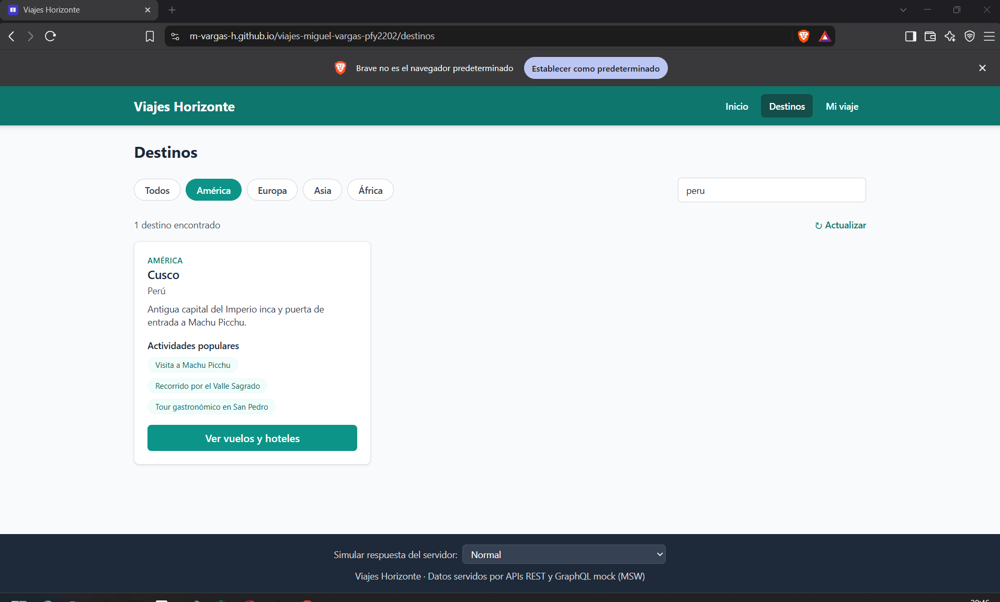

3. **Detalle de destino:** vuelos y hoteles obtenidos por GraphQL y cambio de pestaña (tablet).

   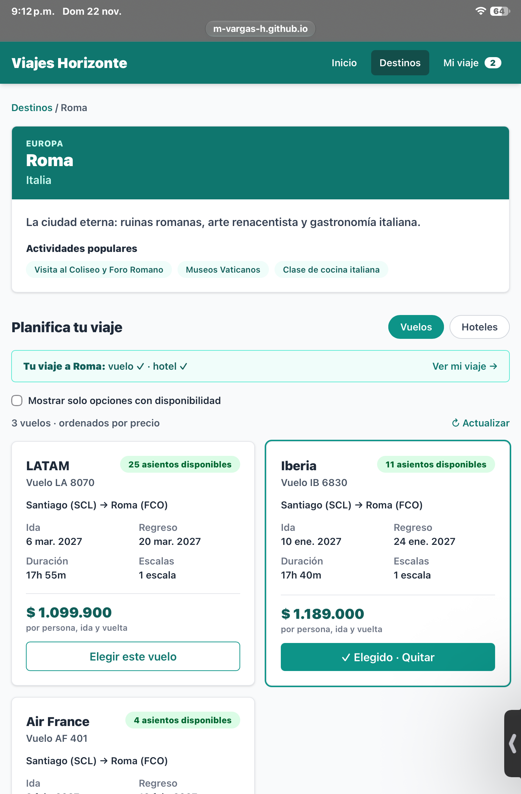

4. **Disponibilidad y orden:** filtro "solo con disponibilidad" y orden por precio (teléfono).

   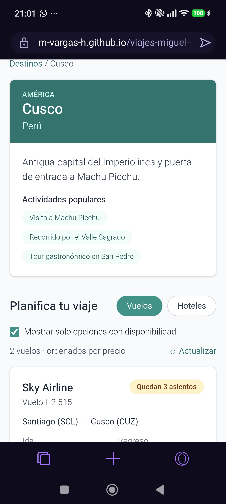

5. **Selección:** elegir vuelo y hotel, y contador en el menú (PC).

   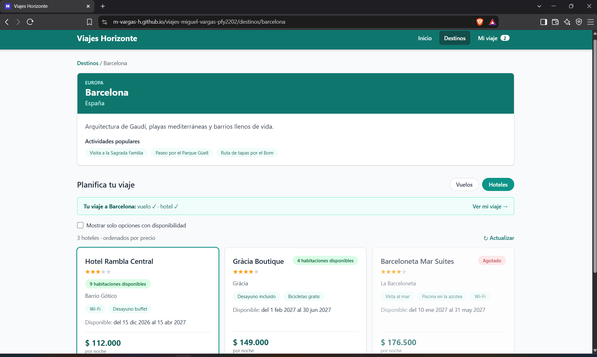

6. **Mi viaje:** cálculo del total, cambio de pasajeros y noches, y el plan se mantiene al recargar (tablet).

   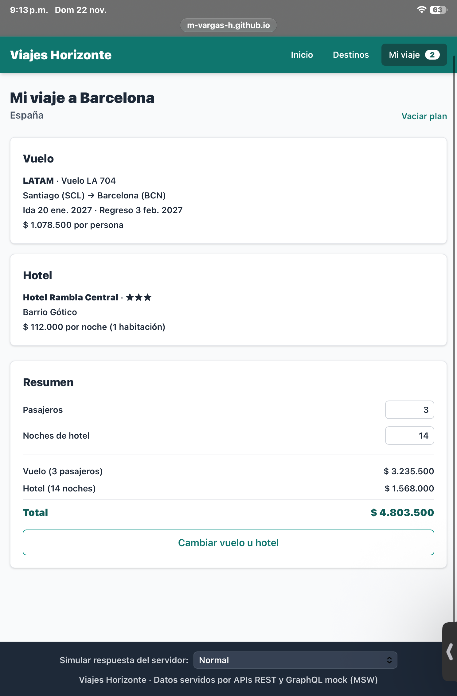

7. **Navegación:** atrás y adelante, recarga en una ruta interna y ruta inexistente (404) (teléfono).

   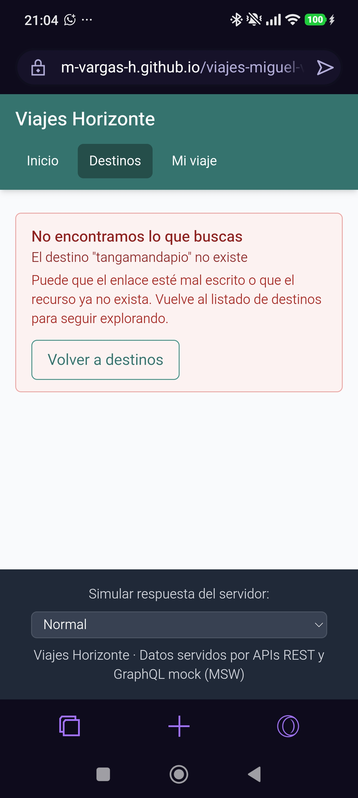

8. **Simulador del servidor:** errores REST y GraphQL con la opción "Reintentar" (PC).

   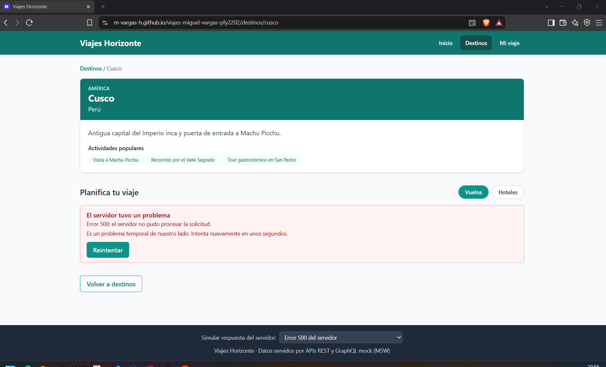

9. **Diseño responsivo:** la vista se adapta al tamaño de pantalla de cada dispositivo (tablet).

   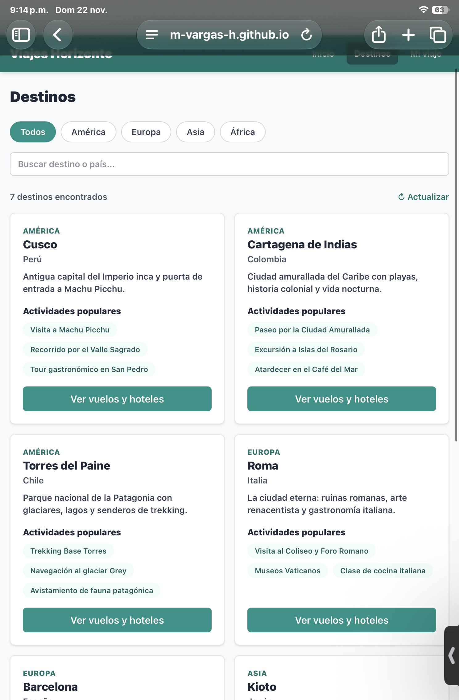

**Compatibilidad:** Tailwind CSS v4 requiere navegadores Chromium 111+ (base de Brave y Opera) y Safari 16.4+. El tiempo límite de las peticiones usa `AbortSignal.any` (Chromium 116+, Safari 17.4+).

## Instalación y ejecución
```bash
npm install
npm run dev
```

## Despliegue
```bash
npm run deploy
```
Genera el build (con `404.html`) y lo publica en la rama `gh-pages`. En el repositorio: **Settings → Pages → Deploy from a branch → `gh-pages` / `(root)`**.
